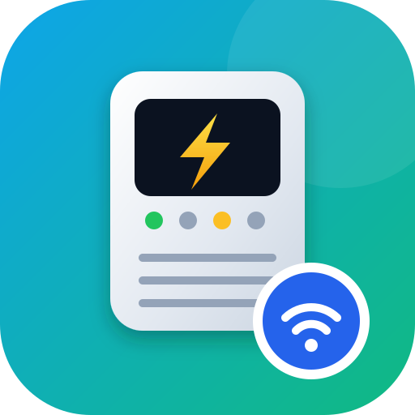

<p align="center">
  
</p>

<h1 align="center">WattSeek Wi-Fi</h1>

<p align="center">
  <b>Local, cloud-free Home Assistant integration for JSD Solar / WattSeek hybrid inverters — over the stick's own Wi-Fi.</b><br>
  The Wi-Fi stick keeps working as shipped, it just talks to your Mosquitto instead of the vendor cloud.
</p>

<p align="center">
  <a href="https://github.com/hacs/integration"></a>
  <a href="https://github.com/dimagord/wattseek-wifi/releases"></a>
  
  
  <a href="LICENSE"></a>
</p>

---

## Why

The WattSeek Wi-Fi stick only uploads to the vendor cloud, every 5 minutes. Its cloud connection, however, is plain MQTT over TLS **without certificate checking**, and the cloud can send it raw Modbus commands. Point the stick at a local broker and Home Assistant can read and write the inverter directly, every few seconds, with no internet at all.

This is the Wi-Fi sibling of [wattseek-ble](https://github.com/dimagord/wattseek-ble): same register map, same entities, different transport. Run both side by side to compare.

## How it works

```
                 TLS (self-signed OK)          MQTT
WattSeek stick ───────────────────────► Mosquitto ◄────── Home Assistant
   │  thinks it is the cloud broker         (HA)          (this integration)
   └── Modbus RTU ──► inverter
```

1. The stick connects to its cloud broker hostname. Your DNS or router sends that connection to Mosquitto on Home Assistant instead.
2. The integration answers the stick's housekeeping requests (sub-device registration, time sync, firmware check) exactly like the cloud does.
3. Every poll it publishes one `thing.service.down` message carrying all the Modbus read frames; the stick runs them against the inverter and publishes the raw answers back.

Details and message formats: [`PROTOCOL.md`](PROTOCOL.md).

Measured on a J6500HC-48 with the stick on the same LAN: one register block ≈ 0.8 s, a full live poll (3 blocks, 133 registers) ≈ 2.5 s, live + settings ≈ 4.3 s. The default update interval is 5 s.

## Requirements

- Home Assistant **2025.1+** with the **MQTT** integration and the **Mosquitto broker** app.
- A way to redirect the stick's broker hostname to Home Assistant: a DNS rewrite (AdGuard Home, Pi-hole, router DNS) or a DNAT rule on the router.
- The stick's MQTT credentials (see below).

⚠️ Once redirected, the vendor app and cloud no longer see the inverter (that is the point). Undo the redirect to go back.

## Setup

### 1. Find the stick's MQTT credentials

The stick uses its **stick id** as both MQTT client id and username, plus a per-device password. Because it does not verify the server certificate, you can read them by letting it connect once to a throwaway TLS server, e.g. on an OpenWrt router:

```sh
openssl req -x509 -newkey rsa:2048 -nodes -keyout k.pem -out c.pem -days 1 -subj "/CN=test"
openssl s_server -accept 18883 -cert c.pem -key k.pem -msg &
iptables -t nat -I PREROUTING -s <stick-ip> -p tcp --dport 8883 -j REDIRECT --to-ports 18883
conntrack -D -s <stick-ip> -p tcp --dport 8883   # make it reconnect
```

The MQTT `CONNECT` packet in the output shows the client id, username (same) and password. Remove the rule afterwards.

### 2. Enable TLS on Mosquitto

Mosquitto opens its TLS listener on **8883** as soon as the certificate files exist. Any self-signed certificate works:

```sh
openssl req -x509 -newkey rsa:2048 -nodes -days 3650 \
  -keyout wattseek_mqtt.key -out wattseek_mqtt.crt -subj "/CN=iot-broker-eur.ifpserver.com"
```

Copy both files into the Home Assistant `/ssl` folder, then in the Mosquitto app configuration:

```yaml
certfile: wattseek_mqtt.crt
keyfile: wattseek_mqtt.key
logins:
  - username: "<stick id>"
    password: "<stick password>"
```

Restart Mosquitto.

### 3. Redirect the stick

The stick's broker is `iot-broker-eur.ifpserver.com:8883` (EU region). Either:

- **DNS rewrite** `iot-broker-eur.ifpserver.com → <HA IP>` in AdGuard Home / Pi-hole / your router, then power-cycle the stick or wait for it to reconnect; or
- **Router DNAT** (OpenWrt, add to `/etc/firewall.user`):

  ```sh
  iptables -t nat -I PREROUTING -m mac --mac-source <stick MAC> -p tcp --dport 8883 -j DNAT --to-destination <HA IP>:8883
  iptables -t nat -I POSTROUTING -s <LAN>/24 -d <HA IP> -p tcp --dport 8883 -j MASQUERADE
  ```

The Mosquitto log should show `New client connected ... as <stick id>`.

### 4. Install the integration

**HACS:** *HACS → ⋮ → Custom repositories →* `https://github.com/dimagord/wattseek-wifi` (type *Integration*) → install **WattSeek Wi-Fi** → restart Home Assistant.

As soon as the stick publishes on the broker, Home Assistant offers to add it (MQTT discovery). You can also add it manually with the product key and stick id from its topic `/sys/<product key>/<stick id>/thing/post`.

## Configuration

*Settings → Devices & services → WattSeek Wi-Fi → Configure*

| Option | Default | |
|---|---|---|
| Update interval | 5 s | 1–600 s. Each poll is one MQTT round trip; the settings block is added once a minute. |
| Allow changing inverter settings | off | Enables the select / number / switch controls. |

## Entities

The same as [wattseek-ble](https://github.com/dimagord/wattseek-ble#entities): ~70 sensors (grid, load/output, battery, PV, temperatures, energy counters), decoded status / charging stage / faults / warnings, and the guarded controls (priorities, operating mode, AC charging current, voltage setpoints, remote power).

Wi-Fi-specific diagnostics:

| Entity | |
|---|---|
| Wi-Fi signal | RSSI the stick reports (dBm), with SSID as an attribute |
| Last message from stick | Any message, including its own 5-minute uploads |
| Response time / max | MQTT passthrough round trip of the last poll (ms) |
| Poll duration | Whole poll (ms) |
| Request errors | Passthrough requests that got no answer |

The stick's own periodic uploads are merged in as well, so data keeps flowing even with a long update interval.

## Troubleshooting

- **No discovery / entities unavailable** — check the Mosquitto log for the stick connecting on 8883. If it isn't, the redirect is not in effect (DNS cached, or the stick still has an open cloud session: power-cycle it).
- **Stick connects but no data** — enable debug logging and look for `stick registers inverter`: the integration must be running for the stick to finish registration.

```yaml
logger:
  logs:
    custom_components.wattseek_wifi: debug
```

## Українською

Локальна інтеграція для інверторів JSD Solar / WattSeek через їхній власний Wi-Fi модуль, без хмари. Модуль підключається до хмарного брокера MQTT по TLS, але не перевіряє сертифікат, тож його можна перенаправити на Mosquitto в Home Assistant (TLS-порт 8883 із самопідписаним сертифікатом, логін модуля, підміна DNS або DNAT на роутері). Інтеграція відповідає модулю замість хмари і через команду прямої передачі Modbus читає та пише регістри кожні кілька секунд. Карта регістрів і сутності — ті самі, що й у [wattseek-ble](https://github.com/dimagord/wattseek-ble), тож їх зручно порівнювати.

## Credits & disclaimer

- Register map and entity layer shared with [wattseek-ble](https://github.com/dimagord/wattseek-ble) (JSD Solar Modbus protocol V1.20, community ESPHome JSDSolar config).
- The MQTT protocol was observed on the owner's own hardware for interoperability.

This project is unofficial and not affiliated with WattSeek, CVTE or JSD Solar. Changing inverter settings can damage equipment or batteries — use the write option deliberately and at your own risk.

Licensed under the [MIT License](LICENSE).
